# Actividad 2 — Registro en pruebas cerradas y retroalimentación de aplicaciones móviles

<p align="center">
  <b>Instituto Politécnico Nacional</b><br>
  <b>Escuela Superior de Cómputo (ESCOM)</b><br>
  Ingeniería en Sistemas Computacionales — Plan 2020<br>
  Unidad de aprendizaje: <b>Desarrollo de aplicaciones móviles nativas</b>
  <b>Alumno:</b> Caballero Pérez Julio César<br>
  <b>Grupo:</b> 7CV4<br>
</p>


## Índice

1. [Objetivo](#1-objetivo)
2. [Metodología de prueba](#2-metodología-de-prueba)
3. [Parte 1 — Aplicación 1: Five Nights at ESCOM](#3-parte-1--aplicación-1-five-nights-at-escom)
4. [Parte 2 — Aplicación 2: Salones](#4-parte-2--aplicación-2-salones)
5. [Parte 3 — Evaluación de AUTECH](#5-parte-3--evaluación-de-autech)
6. [Resumen de pruebas](#6-resumen-de-pruebas)
7. [Conclusiones](#7-conclusiones)

---

## 1. Objetivo

Participar como persona probadora (*tester*) en dos aplicaciones distribuidas mediante pruebas cerradas de Google Play, documentar su instalación y funcionamiento con evidencias reales, y posteriormente evaluar la aplicación **AUTECH** mediante observaciones positivas, negativas y el formulario de retroalimentación solicitado.

## 2. Metodología de prueba

Para cada aplicación se siguió el mismo procedimiento:

1. **Inscripción:** Abrir el enlace de prueba cerrada con la cuenta de Google autorizada como *tester* y aceptar la participación.
2. **Instalación:** Desde la ficha de Google Play, instalar la aplicación en el dispositivo Android.
3. **Ejecución:** Abrir la aplicación y verificar que inicia correctamente.
4. **Pruebas funcionales:** Explorar las funciones principales y registrar el resultado de cada prueba (✅ correcto / ⚠️ con observaciones / ❌ falla).
5. **Evidencias:** Capturas de pantalla tomadas en el propio dispositivo.


---

## 3. Parte 1 — Aplicación 1: Five Nights at ESCOM

| Campo | Información |
|---|---|
| **Paquete** | `ovh.gabrielhuav.fivenightsatescom` |
| **Inscripción a prueba cerrada** | https://play.google.com/apps/testing/ovh.gabrielhuav.fivenightsatescom |
| **Ficha de Google Play** | https://play.google.com/store/apps/details?id=ovh.gabrielhuav.fivenightsatescom |

### 3.1 Inscripción a la prueba cerrada

Se abrió el enlace de inscripción con la cuenta de Google autorizada y se aceptó la participación como *tester*.

<p align="center">
  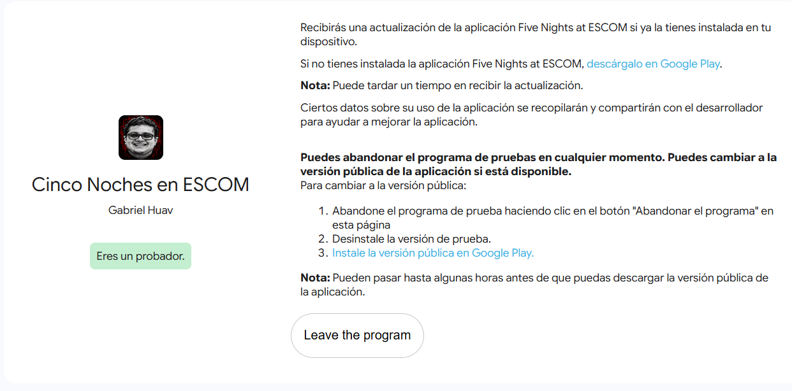
  <br><i>Figura 1. Confirmación de inscripción a la prueba cerrada de Five Nights at ESCOM.</i>
</p>

### 3.2 Instalación y ejecución

Desde la ficha de Google Play se instaló la aplicación y se abrió en el dispositivo.

<p align="center">
  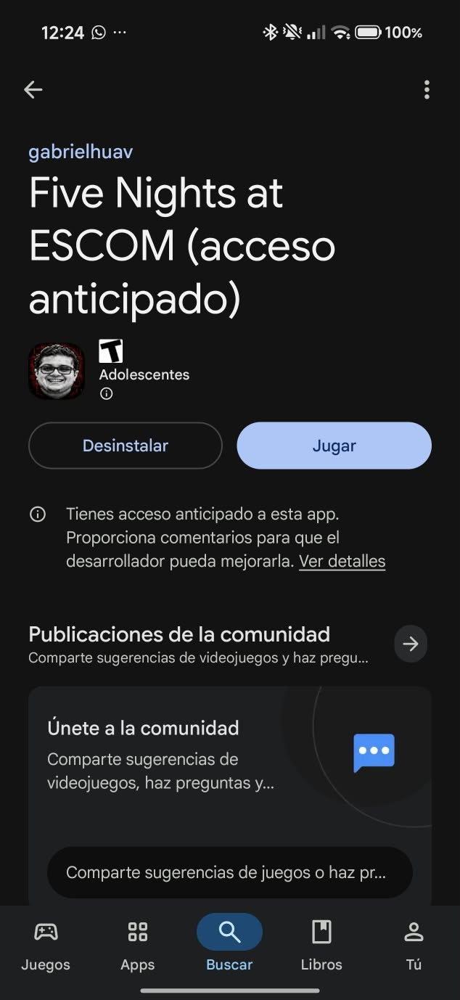
  &nbsp;&nbsp;
   <br><i>Figura 2. Aplicación instalada desde Google Play.
   </i>

</p>
<p align="center">
  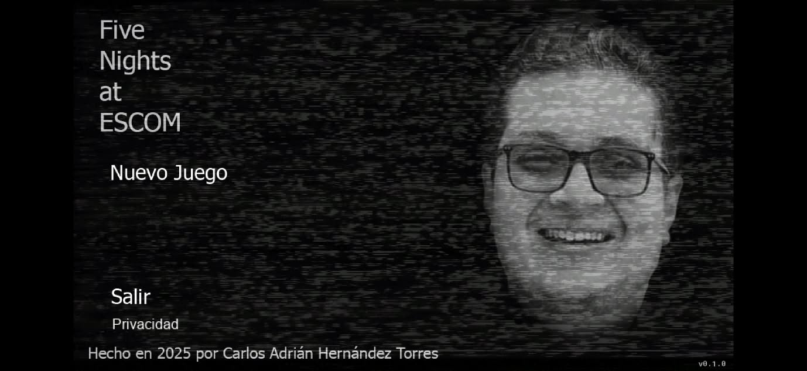
  &nbsp;&nbsp;
   <br><i>FFigura 3. Aplicación abierta y en ejecución.</i>
</p>

### 3.3 Pruebas realizadas

| # | Función probada | Pasos | Resultado esperado | Resultado obtenido | Estado |
|---|---|---|---|---|---|
| P1 | Inicio de la aplicación | Abrir la app desde el ícono | Carga la pantalla principal sin cerrarse | `Se abrio la aplicación sin ningún problema, mostrando correctamente el menú del juego.` | `✅` |
| P2 | Menú principal / navegación | Tocar las opciones del menú | Cada opción abre su pantalla | `Se probaron todas las opciónes en el menú principal, donde se muestra la opción de "Nueva partida" y "Salir"` | `✅` |
| P3 | Iniciar una partida | Seleccionar "Jugar" / nueva noche | Comienza el juego | `Se selecciono la opción de "Nueva partida" y empezo correctamente la introducción al juego y posteriormente se puede empezar a jugar la primera noche. Algo que me llamo la atención es que al momento de seleccionar "Nueva partida" despliega un submenu mostrando las opciónes "Continuar", "Opciones", "Extras" cuando estas deberian de mostrar una vez se finalize la primera noche o al principio del menu principal aún sin iniciar la primera noche.` | `⚠️` |
| P4 | Controles en juego (cámaras, puertas, etc.) | Usar los controles durante la partida | Responden al toque | `Todos los controles funcionan correctamente y reaccionan de manera correcta a la interacción del usuario.` | `✅` |
| P5 | Sonido / audio | Jugar con volumen activado | Se escucha música y efectos | `Se escucha algo bajo el volumen al estar dentro del juego.` | `⚠️` |
| P6 | Salir y volver a entrar | Minimizar y regresar a la app | Conserva el estado o regresa al menú | `Al momento de Salir del juego y volver a entrar se queda correctamente en el estado en donde se quedo y la hora.` | `✅` |

<p align="center">
  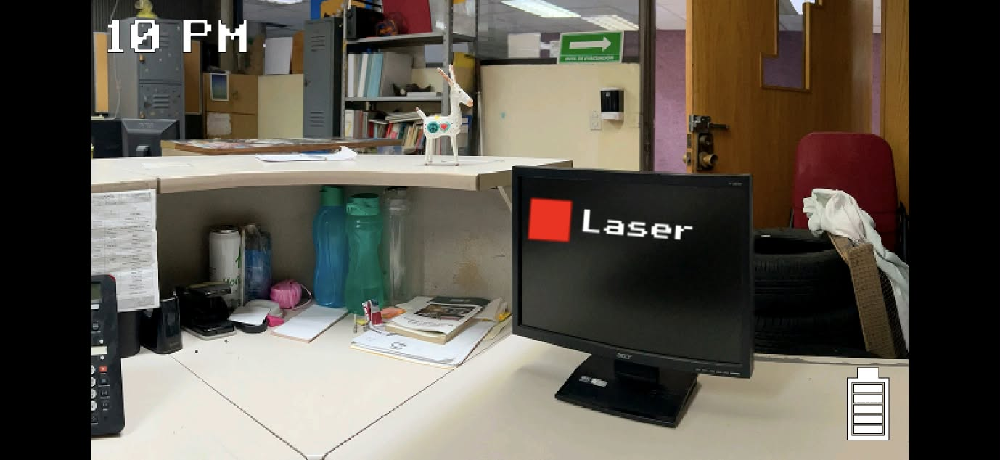
  <br><i>Figura 4. Evidencia de la función probada en Five Nights at ESCOM.</i>
</p>

### 3.4 Observación

> **Observación:** `Todo el juego funciona correctamente , exceptuando la parte de la musica que se escucha bajo, el menú principal que despliega las opciones y se llega observar que aparecen despues de seleccionar la opción de "Nueva partida".`

---

## 4. Parte 2 — Aplicación 2: Salones

| Campo | Información |
|---|---|
| **Paquete** | `ovh.gabrielhuav.salones` |
| **Inscripción a prueba cerrada** | https://play.google.com/apps/testing/ovh.gabrielhuav.salones |
| **Ficha de Google Play** | https://play.google.com/store/apps/details?id=ovh.gabrielhuav.salones |

### 4.1 Inscripción a la prueba cerrada

<p align="center">
  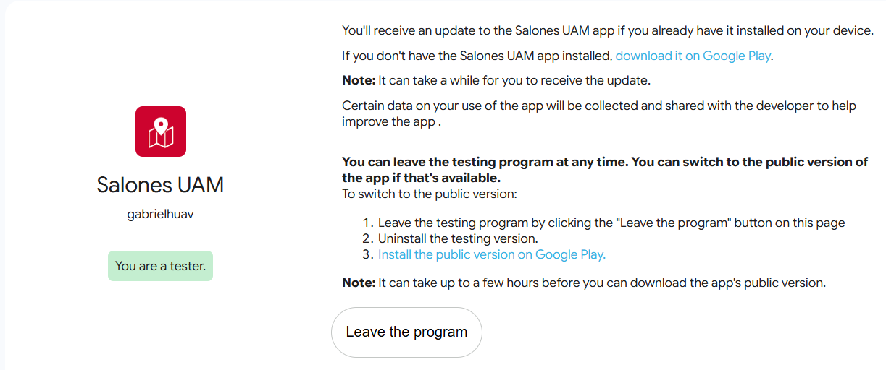
  <br><i>Figura 5. Confirmación de inscripción a la prueba cerrada de Salones.</i>
</p>

### 4.2 Instalación y ejecución

<p align="center">
  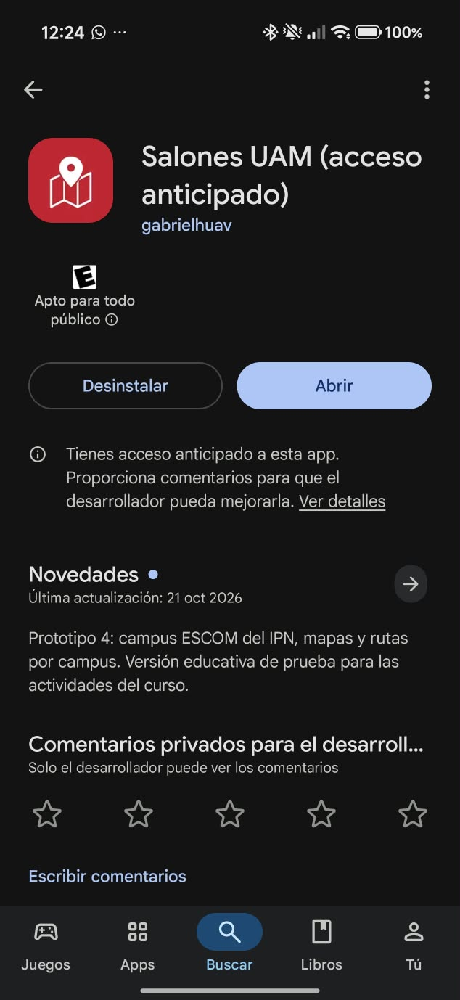<br><i>Figura 6. Aplicación instalada desde Google Play.</i>
  &nbsp;&nbsp;
  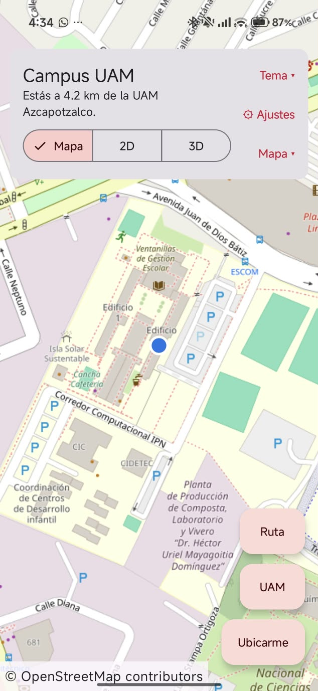
  <br><i>Figura 7. Aplicación abierta y en ejecución.</i>
</p>

### 4.3 Pruebas realizadas

| # | Función probada | Pasos | Resultado esperado | Resultado obtenido | Estado |
|---|---|---|---|---|---|
| P1 | Inicio de la aplicación | Abrir la app desde el ícono | Muestra la pantalla principal | `Al momento de presionar el icono de la app la abre correctamente y muestra el mapa de la UAM` | `✅` |
| P2 | Consulta / búsqueda de salones | Buscar o seleccionar un salón | Muestra la información del salón | `Al presionar el boton "Ruta" despliega correctamente  el destino y el origen para poder ubicar el salón.` | `✅` |
| P3 | Visualización de la información (mapa, edificio, etc.) | Abrir el detalle de un salón | Datos legibles y correctos | `En mi caso no pude abrir los detalles del salón,lo unico que me muestra es el tiempo que me hago de mi destino al edificio, lo cual cumple con el objetivo de la aplicación.` | `✅` |
| P4 | Navegación entre pantallas | Usar botón atrás y menús | Regresa a la pantalla anterior | `Todos los botones funcionan correctamente, cumpliendo su objetivo.` | `✅` |
| P5 | Rotación de pantalla | Girar el dispositivo | La interfaz se adapta sin perder datos | `La implementación de la rotación a mi parecer no es del todo comoda para el usuario ya que es algo distinta a las demás aplicaciones que usan la rotación para un mapa, se podria mejorar un poco, pero en general si funciona .` | `⚠️` |

<p align="center">
  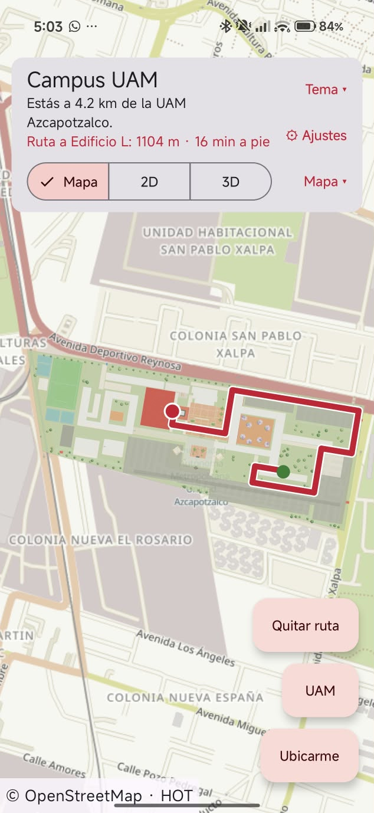
  <br><i>Figura 8. Evidencia de la función probada en Salones.</i>
</p>

### 4.4 Observación

> **Observación:** `Todo funciona correctamente con la aplicación.`

---

## 5. Parte 3 — Evaluación de AUTECH

| Campo | Información |
|---|---|
| **Enlace de inscripción** | `QR  - Proporcionado por los alumnos del profesor` |


### 5.1 Registro, instalación y uso

<div align="center">

  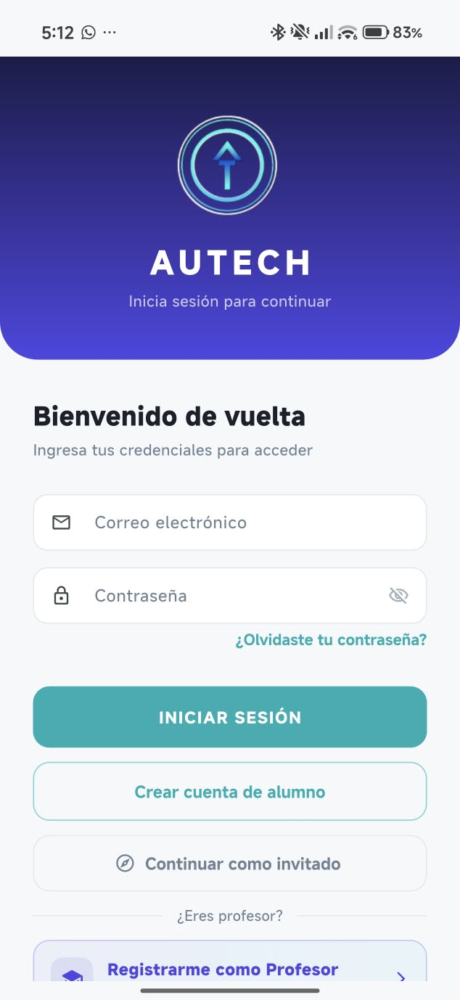

  <p><strong>Figura 9.</strong> Inscripción a la aplicación AUTECH.</p>

</div>

<div align="center">

  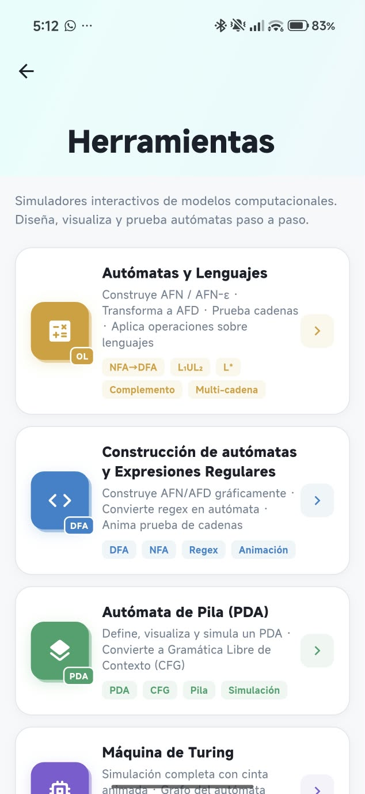

  <p><strong>Figura 10.</strong> AUTECH en ejecución.</p>

</div>

<div align="center">

  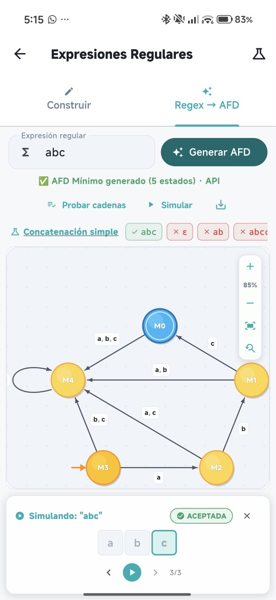

  <p><strong>Figura 11.</strong> Uso de una función principal de AUTECH.</p>

</div>
### 5.2 Pruebas realizadas

| # | Función probada | Pasos | Resultado esperado | Resultado obtenido | Estado |
|---|---|---|---|---|---|
| P1 | Inicio de la aplicación | Abrir la app | Carga correctamente | `[...]` | `[...]` |
| P2 | `[Función principal 1]` | `[...]` | `[...]` | `[...]` | `[...]` |
| P3 | `[Función principal 2]` | `[...]` | `[...]` | `[...]` | `[...]` |
| P4 | `[Función principal 3]` | `[...]` | `[...]` | `[...]` | `[...]` |

### 5.3 Aspectos positivos

| # | Aspecto | Descripción |
|---|---|---|
| 1 | `[ej. Navegación]` | `[Explica brevemente la fortaleza observada]` |
| 2 | `[ej. Utilidad]` | `[...]` |
| 3 | `[ej. Rendimiento / claridad]` | `[...]` |

### 5.4 Aspectos negativos

| # | Problema / limitación | Contexto en que se presenta | Sugerencia de mejora |
|---|---|---|---|
| 1 | `[...]` | `[Pantalla o acción donde ocurre]` | `[...]` |
| 2 | `[...]` | `[...]` | `[...]` |
| 3 | `[...]` | `[...]` | `[...]` |

### 5.5 Formulario de retroalimentación

Se respondió el formulario de retroalimentación solicitado por el docente.

<p align="center">
  
  <br><i>Figura 12. Confirmación de envío del formulario (sin datos personales visibles).</i>
</p>

---

## 6. Resumen de pruebas

| Aplicación | Inscripción | Instalación | Ejecución | Pruebas OK | Observaciones |
|---|---|---|---|---|---|
| Five Nights at ESCOM | `[✅/❌]` | `[✅/❌]` | `[✅/❌]` | `[x / 6]` | `[Resumen en una línea]` |
| Salones | `[✅/❌]` | `[✅/❌]` | `[✅/❌]` | `[x / 5]` | `[...]` |
| AUTECH | `[✅/❌]` | `[✅/❌]` | `[✅/❌]` | `[x / 4]` | `[...]` |

> **Incidencias:** `[Si alguna prueba cerrada no permitió inscribirse o instalar, describe el mensaje mostrado, incluye su captura y anota que se comunicó al docente. Si no hubo, escribe "Sin incidencias".]`

---

## 7. Conclusiones

`[Redacta un párrafo breve sobre lo aprendido: cómo funcionan las pruebas cerradas en Google Play, la importancia de la retroalimentación de los testers antes de publicar una app, y qué aplicación tuvo mejor experiencia y por qué.]`

---

## Estructura del repositorio

```
.
├── README.md
└── capturas/
    
```
